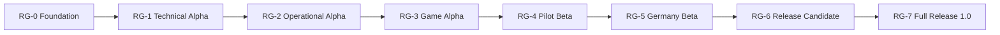

# Zugfolge roadmap to Full Release 1.0

**Status:** active delivery plan

**Baseline:** 30 July 2026

**Machine-readable source:** [`planning/milestones.yaml`](../planning/milestones.yaml)

The former six broad phases remain useful as a vision, but they are too large
for safe AI implementation. This roadmap replaces them as the delivery
breakdown: eight release gates contain 43 independently commissioned
milestones. A milestone can contain several bounded feature pull requests, but
it has one outcome and one measurable exit gate.

## Current position

- `MS-000` is complete: the repository, product constitution, initial
  contracts, demo, reference kernel, CI, service map, and license brief exist.
- `MS-001` is in progress as the parallel human/legal track: its preparation
  register is integrated and the owner license slice is being published.
- `MS-002` is the next technical milestone.
- No milestone after `MS-000` is complete; bounded preparation and active
  slices remain subject to their exit gates.
- The project becomes **Full Release 1.0 only after `MS-074` and its 30-day
  production stabilization gate**. Deployment alone is not a full release.

The recommended next sequence is:

```text
MS-002 reproducible toolchains
  → MS-003 runtime and determinism ADRs
  → MS-010 in-memory JVM Walking Skeleton
  → MS-004 persistence decisions and local state services
  → MS-011 durable recovery
  → MS-012 identity and world isolation
  → MS-013 browser/live integration
```

`MS-001` proceeds in parallel because code licensing, trademark, domain, data
rights, and contribution rules need accountable human decisions. It clears the
sources required through `RG-4` and records later sources such as realistic
disruption feeds as explicit future gates; a deferral is never an approval.

## How to start one milestone

1. Choose only a milestone whose dependencies are `completed`.
2. Create a GitHub milestone named `[MS-nnn] <title>`.
3. Run the [milestone kickoff prompt](../planning/MILESTONE_PROMPT.md).
4. First produce the required specs, ADRs, contracts, and bounded feature
   issues. Do not start with a large implementation diff.
5. Implement one feature issue at a time and require independent review.
6. Complete the milestone only when every exit criterion has current evidence.

The source file records scope, risk, effort, verification, and human gates for
every milestone. GitHub is the execution view; it must link back to that source
instead of silently redefining the milestone.

## Release map



### RG-0 — Foundation

| ID | Milestone | Status |
|---|---|---|
| `MS-000` | Repository and product foundation | completed |
| `MS-001` | Rights, license, brand, and source clearance | in-progress |
| `MS-002` | Reproducible polyglot engineering baseline | ready |
| `MS-003` | Walking Skeleton runtime and determinism architecture | planned |

Exit: product and delivery rules, ownership path, reproducible TypeScript,
Kotlin, and Python toolchains, and the in-memory runtime decisions are complete.

### RG-1 — Technical Alpha

| ID | Milestone | Status |
|---|---|---|
| `MS-010` | JVM Walking Skeleton domain and API | planned |
| `MS-004` | Persistence decisions and self-hosted local state platform | planned |
| `MS-011` | Durable state, outbox, snapshots, and recovery | planned |
| `MS-012` | Identity, authorization, and world isolation | planned |
| `MS-013` | Browser API and live-state integration | planned |

Exit: an authenticated player completes `FEAT-0001` through the real API; crash
recovery and live-stream resync reproduce the same authoritative state.

### RG-2 — Operational Alpha

| ID | Milestone | Status |
|---|---|---|
| `MS-020` | Approved source registry and pilot ingest | planned |
| `MS-021` | Pilot operational graph and quality classes | planned |
| `MS-022` | Infrastructure release and self-hosted dark map | planned |
| `MS-023` | Vehicle catalogue and formation compatibility | planned |
| `MS-024` | Deterministic path, running time, and occupation profiles | planned |
| `MS-025` | Capacity allocation, alternatives, and fair planning | planned |
| `MS-026` | Event-driven simulation, live map, and safe dispatch kernel | planned |

Exit: a pinned Leipzig–Halle–Erfurt release plans and simulates multiple trains
without accepting an incompatible occupation or hiding data gaps.

### RG-3 — Game Alpha

| ID | Milestone | Status |
|---|---|---|
| `MS-030` | Tariff engine, ledger, and economy releases | planned |
| `MS-031` | Fleet assets, maintenance, storage, and financing | planned |
| `MS-032` | Regional personnel and qualification capacity | planned |
| `MS-033` | Liquidity, credit, restructuring, and controlled insolvency | planned |
| `MS-034` | SPFV end to end | planned |
| `MS-035` | SGV end to end | planned |
| `MS-036` | SPNV end to end | planned |
| `MS-037` | Manual construction works and incidents | planned |
| `MS-038` | Deterministic simulated construction works and incidents | planned |
| `MS-040` | Integrated timetable and operations control | planned |

Exit: all three business models complete market, planning, operation, and
settlement loops. Manual and simulated disruption policies are fully playable.

### RG-4 — Pilot Beta

| ID | Milestone | Status |
|---|---|---|
| `MS-050` | Complete desktop UX, PWA, and accessibility | planned |
| `MS-051` | World lifecycle, administration, private worlds, and tutorial | planned |
| `MS-052` | Odoo backoffice, support, and reconciliation | planned |
| `MS-053` | Billing, Zugfolge Plus, cosmetics, and fair entitlements | planned |
| `MS-054` | Validated pilot world and calibrated game releases | planned |
| `MS-055` | Closed pilot, SRE baseline, and pilot exit | planned |

Exit: an invited cohort can operate the 1:1 pilot for at least four continuous
weeks within its SLO and without a double-occupation, ledger, recovery, or
no-pay-to-win violation.

### RG-5 — Germany Beta

| ID | Milestone | Status |
|---|---|---|
| `MS-039` | Authorized realistic disruption feeds | planned |
| `MS-060` | Germany-wide data and release pipeline | planned |
| `MS-061` | Regional simulation ownership and handover | planned |
| `MS-062` | Nationwide planner, multiworld, and live-map scale | planned |
| `MS-063` | Controlled public beta and launch economy | planned |
| `MS-064` | Timetable-date cutover and persistent-world operations | planned |

Exit: approved national releases and realistic feeds support a controlled public
beta; regional handover, planning, live-map load, and release cutover meet their
targets.

`MS-039` is an intentional external gate. Zugfolge must obtain a permitted
provider set or formally change the launch scope. It must never silently replace
a failed or unavailable realistic feed with simulated incidents.

### RG-6 — Release Candidate

| ID | Milestone | Status |
|---|---|---|
| `MS-070` | Security, privacy, legal, and abuse hardening | planned |
| `MS-071` | Supply chain, disaster recovery, and availability | planned |
| `MS-072` | External railway, accessibility, and launch-content audit | planned |
| `MS-073` | Release candidate freeze and go-live rehearsal | planned |

Exit: all launch-blocking findings are closed, the exact signed candidate is
traceable to current evidence, and production-like launch, restore, and rollback
rehearsals pass.

### RG-7 — Full Release 1.0

| ID | Milestone | Status |
|---|---|---|
| `MS-074` | Full Release 1.0 and stabilization | planned |

Exit: the first persistent public Germany world operates for 30 production days
within approved SLO and error budgets with SPFV, SGV, SPNV and all three
disruption policies, no incompatible double occupation, no data loss, and a
fully reconciled ledger.

## Critical path and parallel work

The primary technical path is:

```text
MS-002 → MS-003 → MS-010 → MS-004 → MS-011 → MS-012 → MS-013
→ MS-020 → MS-021 → MS-023 → MS-024 → MS-025 → MS-026
→ MS-030 → MS-034/MS-035/MS-036 → MS-040
→ MS-050/MS-054 → MS-055
→ MS-060 → MS-061/MS-062 → MS-063 → MS-064
→ MS-070/MS-071/MS-072 → MS-073 → MS-074
```

Useful parallel lanes:

- `MS-001` legal, brand, license, and provider clearance;
- map/release work after the pilot graph while vehicle and planner work begins;
- SPFV, SGV, and SPNV after the shared operational and economy kernels;
- UI slices after stable contracts rather than after every backend is finished;
- Odoo and commerce outside the simulation path;
- security, accessibility, privacy, observability, and runbooks continuously,
  with final independent gates in `RG-6`.

## Decisions deliberately not hidden in the roadmap

- The owner-published file-level license mosaic is active in
  `LICENSED_REVIEW_PENDING`; qualified rights-chain, software-license, brand,
  asset, data, and CLA reviews remain blocking `MS-001` gates.
- Production persistence and eventing require accepted ADRs after the in-memory
  Walking Skeleton proves the domain transactions.
- NATS, Valkey, Keycloak, Odoo, and map services are introduced only when their
  first real consumer is implemented.
- Regional simulation, Kubernetes, and ClickHouse require measured need and a
  separate accepted decision.
- Data quality A/B/C needs quantitative coverage and named railway reviewers,
  not only an automated import.
- Persistent worlds need explicit migration, release-cutover, archive,
  inactivity, abandoned-EVU, and rollback rules.
- Because public worlds contain no NPC train operators, cold start and abandoned
  services are product problems, not data that the simulator may invent.

## What “done” means

Every completed milestone must link:

- accepted specs, ADRs, and contract versions;
- feature issues and exact commits;
- migration and rollback evidence;
- tests actually run and their artifacts;
- observability and runbook changes;
- SBOM or artifact digests where applicable;
- independent reviewer and required human approvals;
- open limitations and the next unlocked milestones.

The repository plan, not chat memory, remains authoritative. Status changes
without evidence are invalid.
